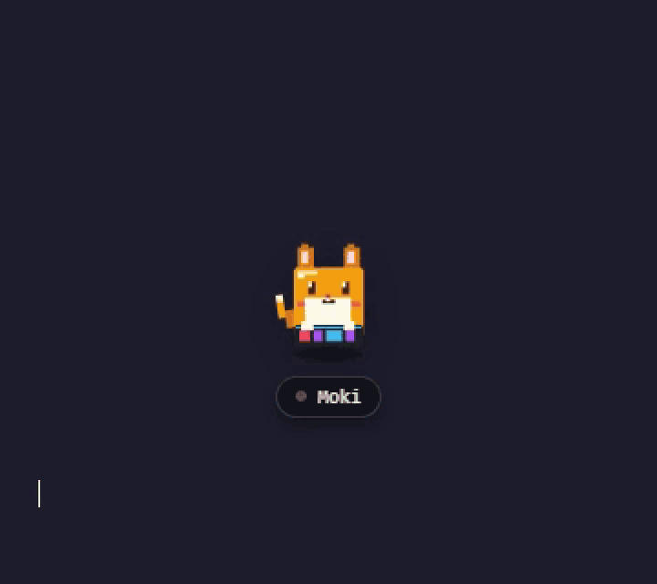
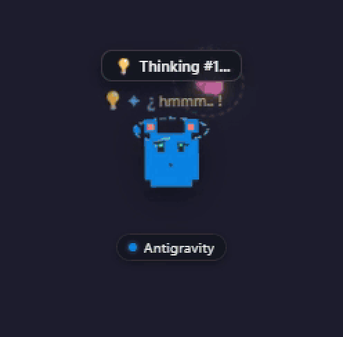
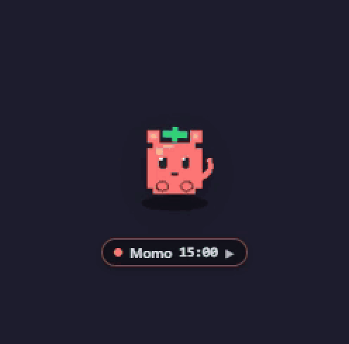
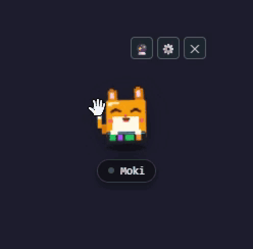

<div align="center">

# 🐾 DevPet

### *Your cyber-companion that watches your AI coding agents so you don't have to babysit them.*

[](https://tauri.app/)
[](https://www.rust-lang.org/)
[](https://vuejs.org/)
[](#-platform-support)
[](#-how-devpet-keeps-tabs-on-your-agents)
[](#)
[](LICENSE)

<p align="center">
  
</p>

### Demos

| Codi tracks your agent | Momo runs your focus timer | Pet Moki |
|:---:|:---:|:---:|
|  |  |  |
| Thinking → working → needs approval → done | Click the timer to start a focus session | Rub or click Moki to pet it |

> **"Stop tab-switching every 20 seconds to see if your AI agent finished or got stuck."**  
> **DevPet** is an ultra-lean desktop companion built on **Tauri + Rust + Vue 3**. It hooks directly into the lifecycles of autonomous coding agents like **Google Antigravity** and **Codex**, mirroring their real-time execution state—thinking, running tools, waiting for approvals, or celebrating completions—straight onto your screen.
>
> 🪟 **Windows 10/11 only for now.** See [Platform Support](#-platform-support).

<p align="center">
  <a href="https://github.com/mazi39662/DevPet/releases/latest"></a>
</p>

> **⬇ [Download the latest Windows installer](https://github.com/mazi39662/DevPet/releases/latest)** (`DevPet_x.y.z_x64-setup.exe`).  
> The installer isn't code-signed yet, so Windows SmartScreen may say *"Windows protected your PC"*. Click **More info → Run anyway**. You can check the file against the SHA256 in the release notes, or build it yourself from source (see [Quickstart](#-quickstart)).

---

</div>

## ⚡ Why DevPet?

When you dispatch agentic coding assistants like **Antigravity**, you typically switch tasks and lose visibility into what the agent is doing. You only realize 15 minutes later that:
- It was waiting for you to approve a shell command or reply to a question.
- It was grinding through tool steps.
- It finished long ago while you were still waiting.

**DevPet solves this.** It floats on your desktop as an animated cyber-familiar (**Moki** the keyboard buddy, **Codi** the agent monitor, or **Momo** the Pomodoro tracker), translating background agent telemetry into instant visual and audio cues.

---

## ✨ Features That Actually Matter

### 🤖 Live AI Coding Agent Monitoring
- **Real-Time Lifecycle Hooking**: Intercepts Antigravity hooks (`PreInvocation`, `PreToolUse`, `PostToolUse`, `Stop`) with zero friction and non-blocking observe-only pass-through.
- **Instant Action Alerts**: The moment your agent needs permission to run commands or answer user questions, your pet triggers a pulsing radar radar badge and alerts you right away.
- **One-Click Target App Focus**: Double-click or click the rocket launcher button on the mascot to immediately pop your agent's IDE window into focus.
- **State-Driven Mascot Expressions**:
  - 💡 **Thinking**: Radiating thoughts and curiosity aura while the agent reasons.
  - ⚡ **Working**: Digital particles and fast typing animations while executing tools.
  - ⏳ **Waiting / Needs Approval**: Pulsing radar alert when the agent needs your green light.
  - 🎉 **Completed**: Victory confetti and fanfare when the task succeeds.
  - ⚠️ **Error**: Panic sweat drops and warning indicator if the turn fails.

### 🍅 Three-Pet Ecosystem
- **Moki (Keyboard Buddy, on by default)**: The pet you meet on first launch. Reacts to your typing with live WPM, peak WPM and speed tiers (casual → flow → fast → *godspeed*), floating key particles, and 12 synthesized keyboard sound profiles (clicky, thock, typewriter, arcade, synthwave…). Gets sleepy after 8 minutes without typing.
- **Codi (Agent Watchdog)**: Tails agent sessions, monitors tool execution, and warns of stuck turns.
- **Momo (Pomodoro Focus)**: 25/5 focus cycles by default (configurable), completed-session count, break reminders, and optional auto-start breaks.
- Run any pet—or all three at once across your multi-display setup! Toggle them from the dashboard or the system tray.

> **Other tools:** Cursor, VS Code, OpenCode / Claude CLI and Ollama are detected by process and get one-click window focus, but no live thinking/done status yet.

### 🖥️ Zero-Distraction Floating Overlay
- **Lightweight by design**: Native Rust backend on WebView2. No heavy Electron bloatware eating your dev machine's resources. (Goal: a small idle footprint; real RAM/CPU numbers coming once measured.)
- **Click-Through / Mini Mode**: Collapse your pet into a compact stealth badge or expand it when you want full status bubbles.
- **Interactive Micro-Physics**: Scratch, boop, drag across monitors, and enjoy responsive procedural retro SFX synthesized via the Web Audio API.

---

## 🔍 How DevPet Keeps Tabs on Your Agents

DevPet talks to your development environment through clean, non-intrusive observation pipelines:

```
┌─────────────────────────────────┐
│     Google Antigravity / IDE    │
└────────────────┬────────────────┘
                 │ Lifecycle events (PreInvocation, PreToolUse, PostToolUse, Stop)
                 ▼
┌─────────────────────────────────┐
│  DevPet Rust Hook CLI & Engine  │ (Tails JSONL event streams, polled every 500 ms)
└────────────────┬────────────────┘
                 │ Emits normalized events (devpet://raw-events)
                 ▼
┌─────────────────────────────────┐
│    DevPet Floating Companion    │ (Real-time animations, audio blips, radar alerts)
└─────────────────────────────────┘
```

| Agent Lifecycle State | DevPet Reaction | What It Means |
|---|---|---|
| **`PreInvocation`** | 💡 Thinking Aura | Model is processing prompt & reasoning next steps |
| **`PreToolUse` (Prompt/Exec)** | ⏳ Pulsing Waiting Radar | Agent is blocked waiting for user input or command approval |
| **`PostToolUse`** | ⚡ Active Code Typing | Tool executed; agent parsing command output or file diffs |
| **`Stop` (Completed)** | 🎉 Confetti & Chime | Task finished successfully! Ready for your review |
| **`Stop` (Error)** | ⚠️ Alert Badge | Command failed or hit recursion limits |

---

## 🛠️ Tech Stack

| Layer | Technology | Details |
|---|---|---|
| **Core Desktop Engine** | [Tauri v2](https://tauri.app/) | Transparent, frameless windowing & OS tray management (Windows / WebView2) |
| **Native Backend** | [Rust](https://www.rust-lang.org/) | Multi-threaded file tailing, process detection & hook CLI |
| **Frontend UI** | [Vue 3](https://vuejs.org/) + [Vite](https://vitejs.dev/) | Reactive state engine, custom pixel art SVG renderer |
| **Language** | [TypeScript](https://www.typescriptlang.org/) | Strictly typed adapter model & event coordinator |
| **Audio Synthesis** | Web Audio API | Procedural retro sound engine (no bulky external audio files) |

---

## 🪟 Platform Support

DevPet currently targets **Windows 10/11** only.

- The installer is built as a Windows **NSIS** `.exe`.
- One-click IDE focus and the global keyboard listener behind Moki use Win32 APIs and are compiled only on Windows.
- macOS/Linux are **not supported yet**. The code may compile there, but IDE focus, the keyboard hook and the Antigravity hook installer (it writes a Windows `.exe` path) won't work. PRs welcome!

---

## 🔒 Privacy

DevPet runs entirely on your machine. Here's exactly what it touches:

**⌨️ Global keyboard listener (Moki & typing reactions)**
- To react to typing in *any* app, DevPet registers a Windows low-level keyboard hook (`SetWindowsHookExW(WH_KEYBOARD_LL)`).
- On each key-down it sends a timestamp and a coarse key label (A–Z, 0–9, Space, Enter, a few punctuation keys, `★` for everything else) to the pet windows, throttled to one event per 25 ms. The label is only used to draw the floating key particle and is then thrown away.
- The only things saved are your **total keystroke count and peak WPM** (in the app's local storage). What you type is **never** stored, logged, or sent anywhere.
- You can switch it off: **Settings → Desktop Companion Windows → Global Keyboard Listener**. When it's off, key events are ignored right away, and on the next launch the hook isn't installed at all. Moki then only reacts while its own window is focused.

**🤖 Agent monitoring**
- **Antigravity:** if you click *Install Hook* (Codi tab), DevPet adds an entry to `~/.gemini/config/hooks.json` (it makes a `hooks.json.devpet-backup` first) and copies a small hook exe to `%LOCALAPPDATA%\DevPet\bin`. The hook appends only status fields (event name, conversation id, step/tool name, error, workspace path) to `%LOCALAPPDATA%\DevPet\antigravity-events.jsonl`. Prompts, tool arguments and transcripts are not saved. It answers `{}` to every event except `PreToolUse`, where Antigravity requires a decision and DevPet answers `allow`. Click *Uninstall Hook* in the Codi tab to remove the entry.
- **Codex:** DevPet reads `~/.codex/sessions/**/*.jsonl` and keeps only event type, turn id, session id, timestamp and error. Message content is dropped.
- **Other tools:** process names are scanned every 3 s to detect running IDEs/CLIs.

**🌐 Network**
- DevPet has no analytics or telemetry and makes no internet requests. The UI's Content Security Policy only allows Tauri IPC. The only HTTP call in the code is the Ollama adapter probing your own local Ollama server at `127.0.0.1:11434`.

> ⚠️ Because DevPet uses a keyboard hook and the installer isn't code-signed yet, some antivirus tools or Windows SmartScreen may warn you. The full source is right here, so you can build it yourself if you'd rather.

---

## 🚀 Quickstart

### 📋 Prerequisites

Ensure you have installed (Windows 10/11):
1. **Node.js** (v18+) — [nodejs.org](https://nodejs.org/)
2. **Rust & Cargo** (stable) — [rustup.rs](https://rustup.rs/)
3. **Microsoft C++ Build Tools** & **WebView2** (WebView2 ships with Windows 11)

---

### 📥 Run Locally

1. **Clone the repository:**
   ```bash
   git clone https://github.com/mazi39662/DevPet.git
   cd DevPet
   ```

2. **Install frontend dependencies:**
   ```bash
   npm install
   ```

3. **Start in development mode:**
   ```bash
   npm run tauri dev
   ```
   *Your pet companion and dashboard will boot up on your desktop immediately.*

4. **Build the production release:**
   ```bash
   npm run tauri build
   ```
   *The Windows installer is generated at `src-tauri/target/release/bundle/nsis/`.*

---

## 🎮 Desktop Mascot Controls

```
        (\__/)
        (•ㅅ•)  ~ "Agent is thinking... Stand by!"
       c(  " ")
```

| Action | Gesture | Result |
|---|---|---|
| **Focus Agent IDE** | Double Left-Click (or click 🚀) | Brings Antigravity / your IDE directly to foreground |
| **Open Control Dashboard** | Triple Left-Click (or click ⚙️) | Opens full telemetry dashboard, logs & session tracker |
| **Affection / Scratch** | Click & drag over pet head | Plays warm purr SFX & triggers affection particles 💕 |
| **Wake / Boop** | Single Left-Click | Bounces with an 8-bit squeak and pops status bubble |
| **Relocate** | Click & drag companion body | Drags smoothly anywhere across multi-monitor setups |
| **Hide Mascot** | Click ✕ on hover bar | Sends companion to system tray (restore anytime from tray) |

---

## 📂 Project Architecture

```plaintext
DevPet/
├── src-tauri/             # 🦀 Rust Native Core
│   ├── src/
│   │   ├── hook_cli.rs    # Fast, non-blocking hook runner for agents
│   │   ├── hook_install.rs# Global hooks installer (~/.gemini/config/hooks.json)
│   │   ├── monitor.rs     # Multi-threaded file tailer & system process observer
│   │   ├── windows.rs     # Transparent desktop overlay & focus management
│   │   └── lib.rs         # Tauri IPC command definitions
│   └── tauri.conf.json    # Window geometry, transparency & permission caps
├── src/                   # 🎨 Vue 3 Frontend
│   ├── adapters/          # Agent-specific telemetry parsers (Antigravity, Codex)
│   ├── components/        # CompanionPet (Codi), PomodoroPet (Momo), StatusBadge
│   ├── services/          # Native IPC bridge, sound engine, notifications
│   ├── types/             # Normalized agent state machine types
│   ├── App.vue            # Main Management Dashboard
│   └── CompanionApp.vue   # Floating transparent desktop overlay
├── package.json
└── README.md
```

---

## 🗺️ What's Cooking Next

- [x] Antigravity lifecycle hook integration
- [x] Real-time "Action Required" permission alert radar
- [x] Interactive procedural sound synthesizer
- [x] Focus app window switcher on double-click
- [x] ⌨️ Moki keyboard pet with WPM tracking & 12 keyboard sound profiles
- [x] 🍅 Momo Pomodoro pet
- [ ] 🚀 Start on Windows login (autostart)
- [ ] 🌱 Git activity reactions (celebrate commits/pushes, react to failing tests)
- [ ] 📏 Measured RAM/CPU numbers in the README
- [ ] 🤖 Claude Code & OpenCodeInterpreter adapter presets
- [ ] 📊 Token velocity & task time analytics in dashboard
- [ ] 🎨 Custom pixel skins & retro synthwave desktop themes

---

## 🤝 Contributing

Contributions, feature suggestions, and agent adapter requests are warmly welcomed!

1. Fork the Project
2. Create your Feature Branch (`git checkout -b feature/AddClaudeCodeAdapter`)
3. Commit your Changes (`git commit -m 'feat: add adapter for Claude Code'`)
4. Push to the Branch (`git push origin feature/AddClaudeCodeAdapter`)
5. Open a Pull Request

---

## 📄 License

Distributed under the **MIT License**. See `LICENSE` for details.

<div align="center">

Built for developers who pair program with AI agents. 🐾🚀  
*If DevPet saved you from babysitting your terminal, drop a ⭐ on the repo!*

</div>
